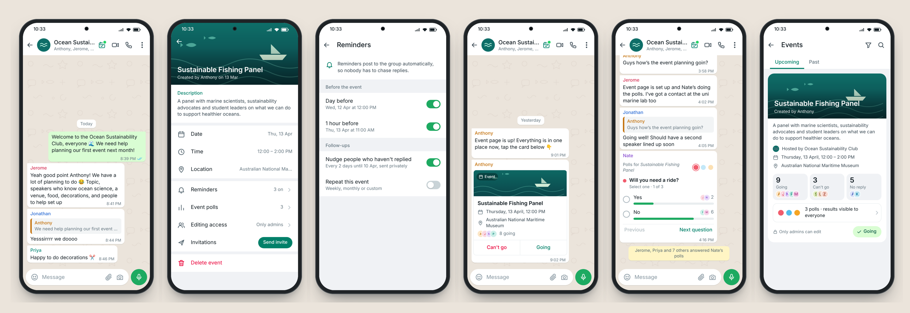
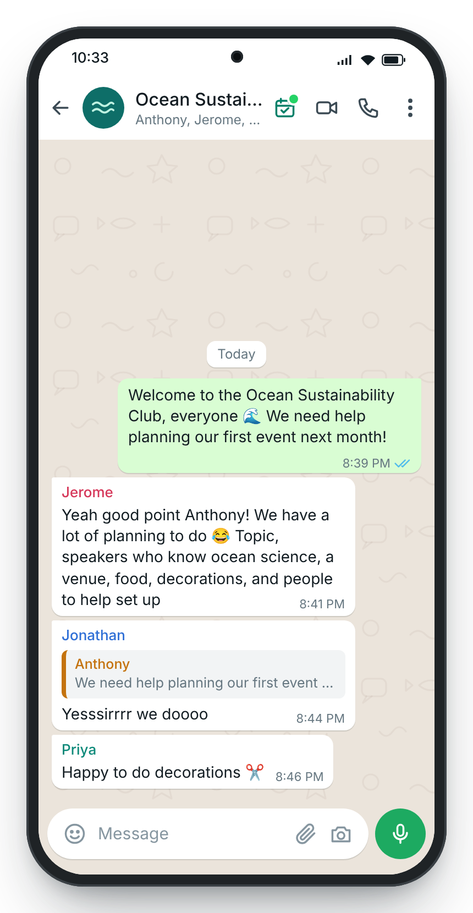
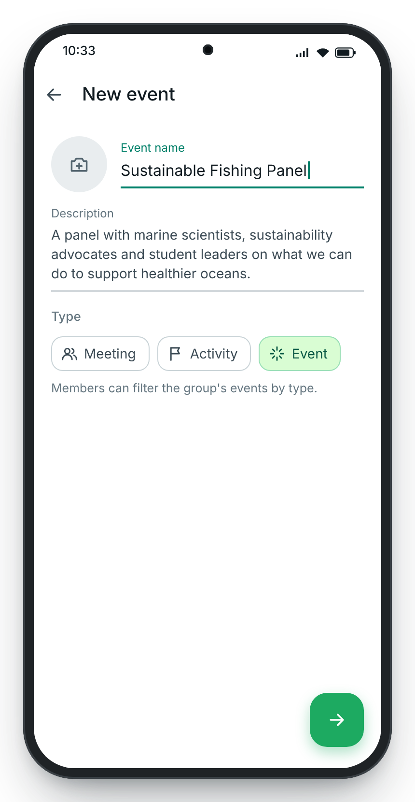
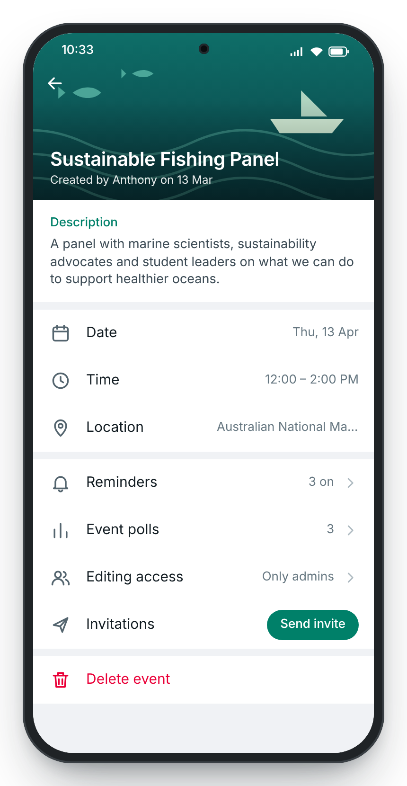
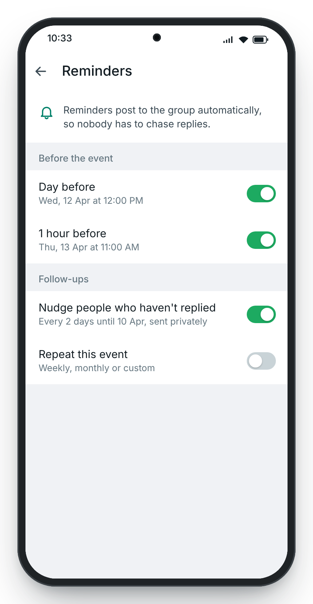
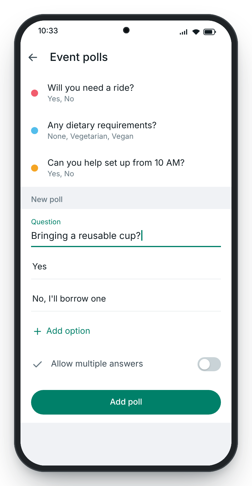
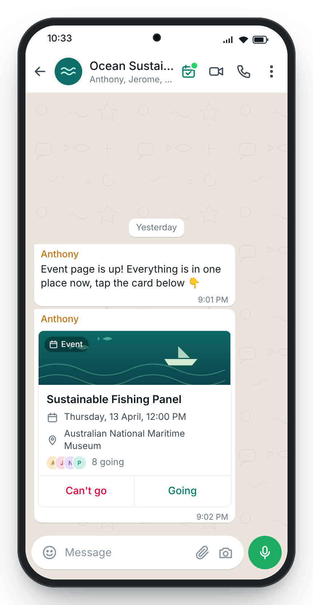
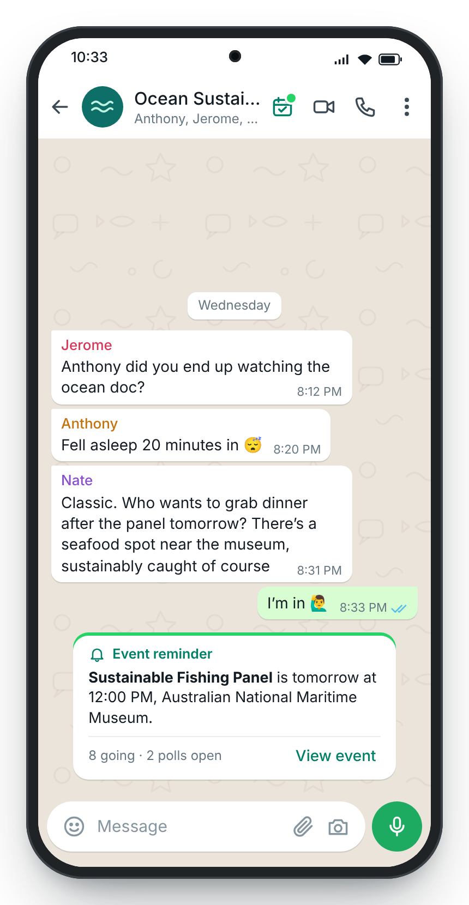
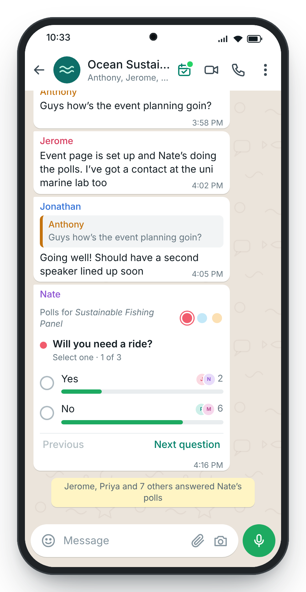
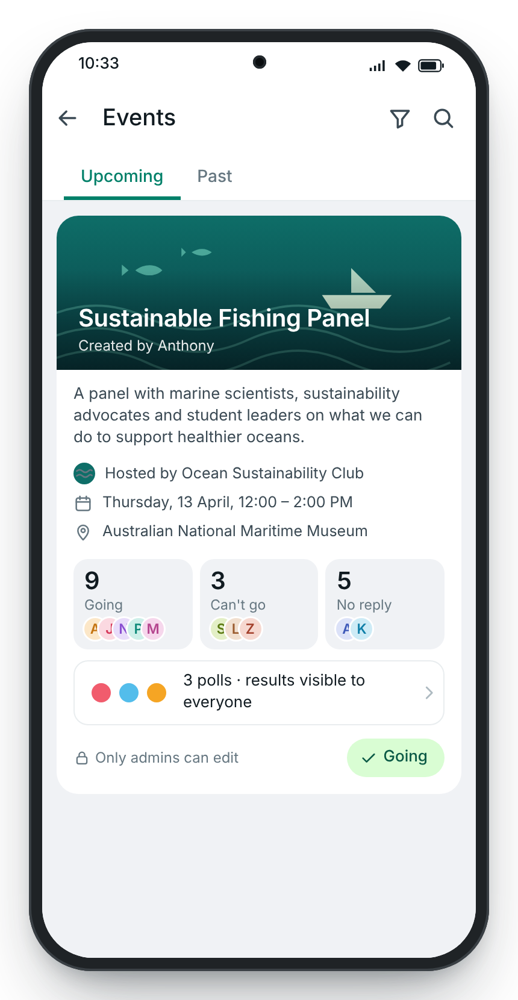

# Group Events: a WhatsApp feature concept

> **Not affiliated with WhatsApp or Meta.** This is an independent, unofficial concept made for fun as a product sense case study. It isn't a real or planned feature, and it isn't endorsed by or connected to WhatsApp or Meta Platforms, Inc. WhatsApp is a trademark of Meta Platforms, Inc. All people, groups and messages in the prototype are fictional.



**Plan the event where your group already talks.** Group Events lets a WhatsApp group create an event in a few taps, collect RSVPs and answers with polls, and let automatic reminders do the chasing.

This repo is a landing page for the case study, with a working, tappable mobile prototype of the feature.

## The case in short

- **Problem.** Groups planning events bounce between Google Forms, Sheets, Docs and Facebook Events. Response rates drop, data scatters, and the chat fills with follow-ups. When planning leaves the chat, the conversation follows, which puts daily active users (the north star metric) at risk.
- **Who.** Group chats were segmented by size and scored on impact, scale, frequency and feasibility. **Teams & clubs** (15 to 50 people: sports teams, student clubs) scored highest, 10 out of 12.
- **What.** Three jobs: automate the annoying tasks (reminders and nudges), reduce extra work (events live in the chat), and keep it quick (polls attached to the event). Sub-threads and bots were left out on purpose to keep WhatsApp simple.
- **How.** Launch in Australia in English with a beta cohort of clubs and teams, iterate, measure ratings, events created, response rates and retention, then make the case for an international rollout.

## The flow

| | | |
|---|---|---|
|  **1. Find it in the chat header** |  **4. Name it and pick a type** |  **7. One page for the whole event** |
|  **8. Reminders do the chasing** |  **9. Attach polls to the event** |  **12. RSVP without leaving the chat** |
|  **14. The reminder pings the group** |  **15. Vote inside the conversation** |  **16. See who's coming** |

All 18 screens are in [`screenshots/`](screenshots).

## Running it

It's a static site with no build step. Open `index.html` in a browser, or serve the folder:

```sh
python3 -m http.server 8000
```

### Publishing on GitHub Pages

1. Go to **Settings → Pages** in this repo.
2. Under **Build and deployment**, set **Source** to *Deploy from a branch*, choose **main** and **/ (root)**, and save.
3. The site appears at `https://nweinberg97.github.io/Whatsapp-Events/` after a minute or two.

## Files

| File | What it does |
|---|---|
| `index.html` | Landing page and case study content |
| `styles.css` | Page styles and the in-app phone UI |
| `app.js` | The prototype: renders all 18 screens and handles taps |
| `main.js` | Scroll-synced walkthrough and the screen gallery |
| `screenshots/` | Rendered PNGs of every screen |

## Credits

Concept, research and wireframes by **Nitai Weinberg**. The original proposal is dated February 2023, and the competitor comparison reflects that date. Phone UI is an original recreation in the style of a modern messaging app; no WhatsApp assets or logos are used.
